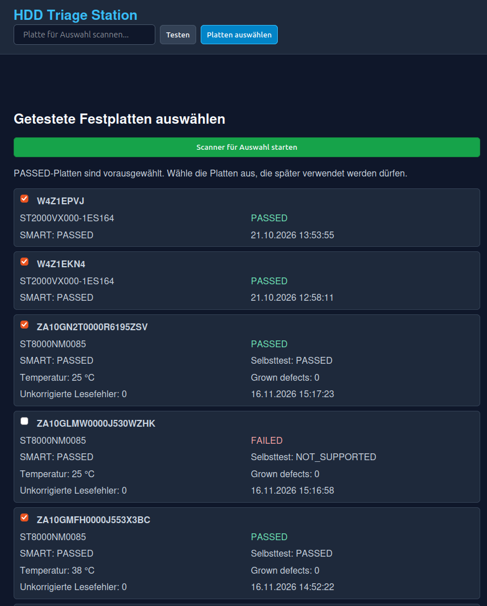

# SmartCheck

SmartCheck is a local Linux web application for testing SAS/SATA hard
drives and selecting drives that are suitable for reuse. It reads the device
identity, starts a short SMART self-test, tracks its progress, reads the final
SMART/SAS report, stores the result in SQLite, and supports barcode selection.

The current interface has **8 test slots**. It is designed primarily for
directly connected SAS drives through a controller that supports SMART/SCSI
passthrough.

## Screenshots

<p>
   
   
</p>

## Requirements

- Linux
- Python 3.10 or newer
- `smartctl` 7.4 or newer from `smartmontools`
- `libcap2-bin` for password-free SMART self-test commands
- Eight or fewer whole-disk devices visible as `/dev/sdX`
- A barcode scanner that behaves like a keyboard, if barcode selection is used

On Debian or Ubuntu:

```bash
sudo apt update
sudo apt install smartmontools libcap2-bin python3 python3-venv python3-pip
```

The application must be able to access the disk devices without running the
web server as root. The following setup is normally required once per PC:

```bash
sudo usermod -aG disk "$USER"
sudo setcap cap_sys_rawio+ep "$(command -v smartctl)"
```

Log out and back in after changing the `disk` group. Verify the capability:

```bash
id -nG
getcap "$(command -v smartctl)"
```

The output of `getcap` should contain:

```text
cap_sys_rawio+ep
```

Do not run the web server
with `sudo` during normal use. Reapply `setcap` after upgrading the
`smartmontools` package if the capability is removed.

## Install and start

Copy the complete `hdd-triage` directory to the new computer. Copy `data/inventory.db` when historical test results must be preserved. Do not copy `venv/`, `.venv/`, `.git/`, or Python `__pycache__` directories; `run.sh` creates the virtual environment automatically.

A portable copy can be created from the development PC:

```bash
cd ~/Desktop
time rsync -av --info=progress2 \
  --exclude='venv/' --exclude='.venv/' --exclude='.git/' \
  --exclude='__pycache__/' hdd-triage/ /media/$USER/USB_NAME/hdd-triage/
```

On the target PC, copy the folder into the home directory and install the
system packages and permissions described above:

```bash
cp -a /media/$USER/USB_NAME/hdd-triage ~/hdd-triage
cd ~/hdd-triage
chmod +x run.sh
./run.sh
```

From the project directory:

```bash
cd ~/hdd-triage
chmod +x run.sh
./run.sh
```

`run.sh` installs the Python dependencies into the local `venv/` directory and
starts Uvicorn at:

```text
http://127.0.0.1:8000/
```

Stop the server with `Ctrl+C`.

The script accepts these database-reset options:

```bash
./run.sh --clear-db
./run.sh --reset
./run.sh -c
```

They permanently delete the local inventory before starting. Do not use them
when historical test results are still needed.

## Disk discovery

Before starting the application, inspect the devices Linux can see:

```bash
lsblk -d -o NAME,PATH,TYPE,TRAN,MODEL,SERIAL,SIZE
```

The application considers only whole `/dev/sdX` disks. It ignores partitions
such as `/dev/sda1` and NVMe devices such as `/dev/nvme0n1`.

The first five seconds after application startup are a quarantine period:

1. All whole disks already visible are recorded as startup disks and ignored.
2. Any disk appearing during those five seconds is also ignored.
3. Only a disk connected after the five-second period is assigned to a slot.
4. A removed startup disk can be detected if it is reconnected after startup.

This prevents the computer's existing system or storage disks from being tested
automatically. To test a disk, start the application first, wait five seconds,
and then connect the disk.

Only eight disks can occupy slots. Additional disks are ignored until a slot
is released.

## Automatic test workflow

After a disk appears after startup, the application:

1. Reads its model and serial number.
2. Starts the short test with the same automatic command that works manually:

   ```bash
   smartctl -t short /dev/sdX
   ```

3. Reads progress every two seconds with:

   ```bash
   smartctl -a /dev/sdX
   ```

4. Converts `XX% of test remaining` into completion progress.
5. After completion, reads the final extended report:

   ```bash
   smartctl -x /dev/sdX
   ```

6. Stores the final result and selected SAS values in `data/inventory.db`.

For SAS disks, the final report uses values that are actually available from
`-x`. ATA-only attribute columns that the SAS device does not provide are not
displayed as fake zeroes.

## Disk decision

A disk receives `PASSED` only when all required checks pass:

- SMART Health Status is `OK`.
- The latest short self-test is `Completed`.
- Temperature is at most 55 C.
- Grown defects are zero.
- Uncorrected read errors are zero.
- Available pending, reallocated, and uncorrectable sector values meet the
  configured zero thresholds.

The five main values shown in the interface are:

- SMART Health
- Short self-test
- Temperature
- Grown defects
- Uncorrected read errors

SAS `Non-medium errors` and SAS link counters such as invalid DWORD,
running-disparity, and loss-of-synchronization counts are retained and shown
as connection warnings when present. They do not automatically fail the disk,
because they may indicate a cable, backplane, or HBA problem rather than a
media defect.

The thresholds are configured in [src/config.py](src/config.py).

## Selecting disks

Click **Platten auswählen** to open the historical inventory. The inventory
contains results from previous runs, not only disks currently connected to the
computer. Drives with `PASSED` are selected automatically; you can change the
checkboxes manually.

Click **Scanner für Auswahl starten**, then scan a drive barcode. The result is:

- **PLATTE NEHMEN**: the barcode belongs to a selected drive with `PASSED`.
- **PLATTE NICHT NEHMEN**: the drive is not selected, is unknown, or did not
  pass.

Barcode values with a trailing period are supported. For example,
`W4Z1EPVJ.` is also checked as `W4Z1EPVJ`.

The selection view shows only the compact decision indicators. Technical
diagnostic messages and unavailable fields are kept out of the scan workflow.

## SMART report and disk wiping

After a test finishes, the complete `smartctl -a` and `smartctl -x` output is
stored in the inventory for that serial number. The report can be opened from
the slot with **SMART-Bericht**.

The current report includes available fields such as SMART health,
accumulated power-on time, current and trip temperature, grown defects,
uncorrected read errors, non-medium errors, SAS link counters, and self-test log
entries. Fields that the controller or disk cannot return are omitted rather
than displayed as zero or `N/A`.

The **Datenträger löschen** action is a destructive operation. It uses:

```bash
dd if=/dev/zero of=/dev/sdX bs=16M status=progress conv=fsync
```

The interface requires the disk serial number and a second confirmation before
starting. It shows bytes written and percentage progress while `dd` runs.
`dd` writes whole disks and must have write access to `/dev/sdX`; the normal
`disk` group may grant that access, or the workstation may use a narrowly scoped
sudo/udev rule for the wipe action. Do not hardcode a password or run Uvicorn
as root merely to enable wiping.

This
operation permanently destroys all data and cannot be undone. Never wipe the
computer's operating-system disk or a disk that is still needed.

Wipe status and completion time are stored per disk in the inventory.

## Changing disks

For each disk change:

1. Wait until the current self-test is complete.
2. Click **Slot freigeben**.
3. Remove the disk.
4. Wait until it disappears from `lsblk`.
5. Insert the next disk.
6. Wait for the new `/dev/sdX` device to appear.

**Slot freigeben does not physically eject a disk.** It only clears the slot
and suppresses rediscovery of that still-connected device. Follow the
controller or enclosure's safe removal procedure.

## Inventory and API

The historical inventory is stored in:

```text
data/inventory.db
```

The JSON inventory endpoint is:

```text
http://127.0.0.1:8000/api/inventory
```

The database stores the serial number, model, test result, self-test result,
SMART health, complete `smartctl -a/-x` report text, available SAS diagnostics,
test duration, slot, timestamp, wipe status, and wipe completion time.

## Troubleshooting

### `No module named uvicorn`

Run the project startup script from the project directory. It installs and
uses the local virtual environment:

```bash
cd ~/hdd-triage
rm -rf venv
./run.sh
```

If virtual-environment creation fails, install `python3-venv` and retry.

### `Permission denied` or `Operation not permitted`

Check both permissions and the raw-I/O capability:

```bash
id -nG
getcap "$(command -v smartctl)"
ls -l /dev/sda /dev/sg* 2>/dev/null
```

The user must be in the `disk` group and `smartctl` should have
`cap_sys_rawio+ep`. Do not hardcode a password and do not run the application
with `sudo` as a permanent workaround.

### The disk is not detected

Confirm that Linux creates a whole-disk node:

```bash
lsblk
ls /dev/sd*
```

If no new `/dev/sdX` appears, check the HBA, bay, power, cable, backplane, and
controller before investigating the application.

### The self-test is unsupported

Test the same command manually:

```bash
smartctl -t short /dev/sdX
smartctl -a /dev/sdX
```

The output must include self-test progress and a self-test log. If the device
reports `Operation not supported`, the disk/controller path cannot provide a
usable short self-test result.

### The browser shows old layout or JavaScript

Reload with:

```text
Ctrl+Shift+R
```

The page uses versioned static asset URLs to avoid stale browser caching.

## Project structure

```text
hdd-triage/
├── run.sh
├── requirements.txt
├── data/
│   └── inventory.db
├── src/
│   ├── main.py
│   ├── monitor.py
│   ├── smart_logic.py
│   ├── database.py
│   └── config.py
├── templates/
│   └── index.html
└── static/
    ├── js/main.js
    └── css/style.css
```
